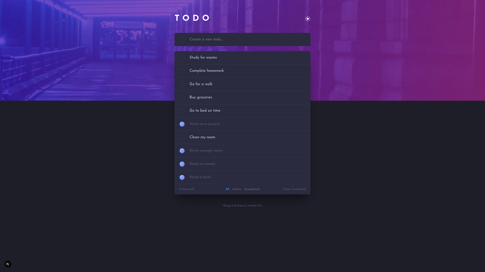
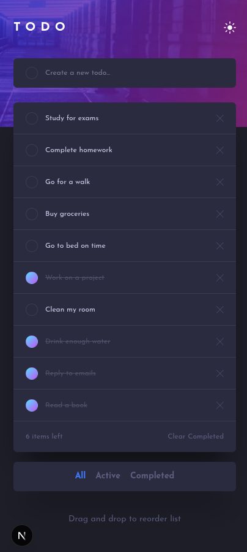
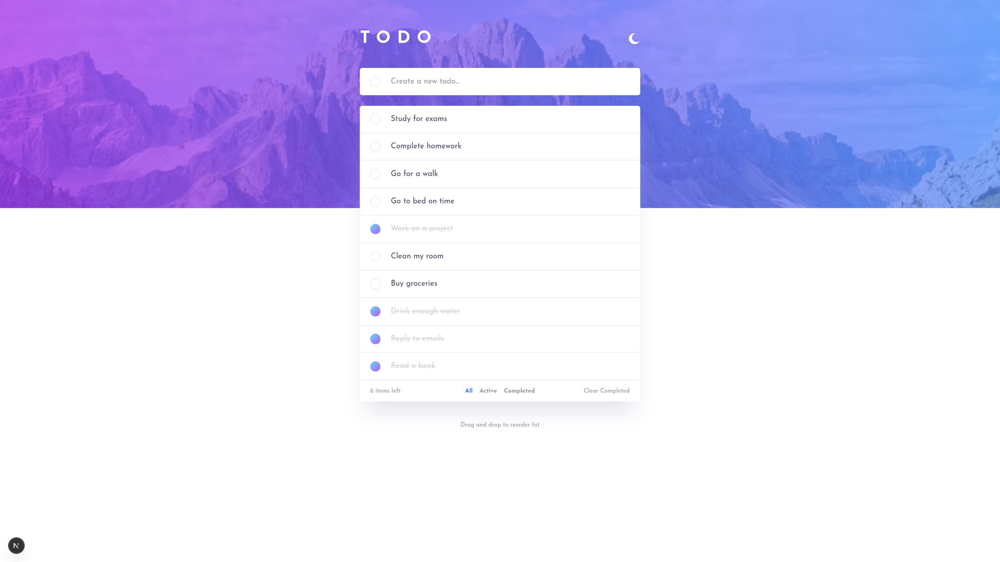
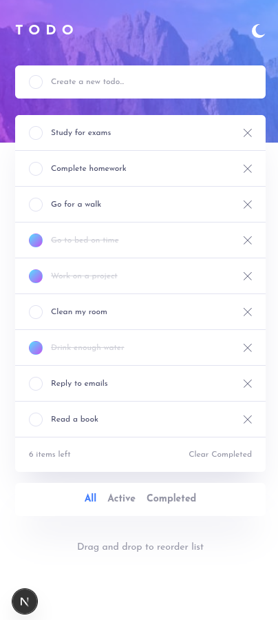

# ✨ Todo List

A modern, responsive, and interactive **Todo List application** built with **Next.js, React, and TypeScript**. Organize your daily tasks, track your progress, and stay productive with a clean interface and intuitive task management.

> Build better habits, one task at a time.

---

## 🖥️ Preview

### 🌙 Dark Mode

**Desktop**



**Mobile**



### ☀️ Light Mode

**Desktop**



**Mobile**



---

## 🚀 Features

- 📝 **Task Management** — Create and manage your tasks with ease.
- ✅ **Task Completion** — Mark tasks as completed or active.
- 🗑️ **Task Deletion** — Remove tasks you no longer need.
- 🔀 **Drag & Drop Sorting** — Rearrange tasks by dragging them into your preferred order.
- 🔎 **Task Filtering** — Filter tasks by All, Active, and Completed.
- 🧹 **Clear Completed** — Remove all completed tasks at once.
- 🌙 **Dark & Light Themes** — Switch between themes.
- 📱 **Responsive Design** — Optimized for desktop and mobile screens.

---

## 🛠️ Tech Stack

| Technology         | Purpose                                 |
| ------------------ | --------------------------------------- |
| **Next.js 16**     | React framework and application routing |
| **React 19**       | Interactive user interfaces             |
| **TypeScript**     | Static typing and code reliability      |
| **Tailwind CSS 4** | Responsive styling                      |
| **@dnd-kit/react** | Drag-and-drop functionality             |
| **next-themes**    | Theme management                        |

---

## ⚙️ How It Works

### 📝 1. Task Management

Create new tasks, mark them as completed, or delete them. The interface updates dynamically as you interact with your list.

### 🔀 2. Drag & Drop

Reorganize your tasks by dragging them into your preferred positions. Task reordering is available when viewing all tasks.

### 🔎 3. Filtering

Choose between three different views:

- **All** — Displays every task.
- **Active** — Displays unfinished tasks.
- **Completed** — Displays finished tasks.

### 🌙 4. Theme Switching

Switch between light and dark themes for a comfortable viewing experience.

---

## 🔌 API

The application uses **Next.js Route Handlers** to handle task operations.

| Method   | Endpoint         | Description              |
| -------- | ---------------- | ------------------------ |
| `GET`    | `/api/todos`     | Retrieve all tasks       |
| `POST`   | `/api/todos`     | Create a new task        |
| `PATCH`  | `/api/todos`     | Update task ordering     |
| `GET`    | `/api/todos/:id` | Retrieve a specific task |
| `PATCH`  | `/api/todos/:id` | Update a task            |
| `DELETE` | `/api/todos/:id` | Delete a task            |

---

## 📁 Project Structure

```text
todo-list/
├── Screenshots/
│   ├── Dark_desktop.png
│   ├── Dark_mobile.png
│   ├── Light_desktop.png
│   └── Light_mobile.png
├── app/
│   ├── api/
│   │   └── todos/
│   │       ├── [id]/
│   │       │   └── route.ts
│   │       └── route.ts
│   ├── components/
│   │   ├── Filter.tsx
│   │   ├── Header.tsx
│   │   ├── Input.tsx
│   │   └── List.tsx
│   ├── globals.css
│   ├── layout.tsx
│   ├── page.tsx
│   └── providers.tsx
├── lib/
│   ├── todos.ts
│   └── types.ts
├── public/
├── package.json
└── tsconfig.json
```

---

## 💻 Installation & Setup

### 1. Clone the repository

```bash
git clone https://github.com/LEVANIKAPANADZE/ToDo-list.git
cd ToDo-list
```

### 2. Install dependencies

```bash
npm install
```

### 3. Start the development server

```bash
npm run dev
```

### 4. Open the application

Visit [http://localhost:3000](http://localhost:3000) in your browser. 🚀

### Production Build

```bash
npm run build
npm run start
```

---

## ⚠️ Storage Note

Tasks are currently stored in memory rather than a database. This means task data is reset when the server restarts.

---

## 🧠 What I Learned

- Building applications with the Next.js App Router.
- Managing application state with React.
- Creating API endpoints with Next.js Route Handlers.
- Implementing drag-and-drop functionality.
- Creating responsive interfaces with Tailwind CSS.
- Managing themes with next-themes.
- Structuring applications with reusable components.

---

## 🧑‍💻 Author

**Levani Kapanadze**

Front-End Developer | React & Next.js Enthusiast

[GitHub Profile](https://github.com/LEVANIKAPANADZE)

> "Build. Break. Learn. Repeat."

---

## ⭐ Support

Enjoying the project?

- ⭐ Give the repository a star.
- 🍴 Fork it and experiment with your own ideas.
- 💬 Share your feedback and suggestions.

Thanks for checking out my project! ❤️
